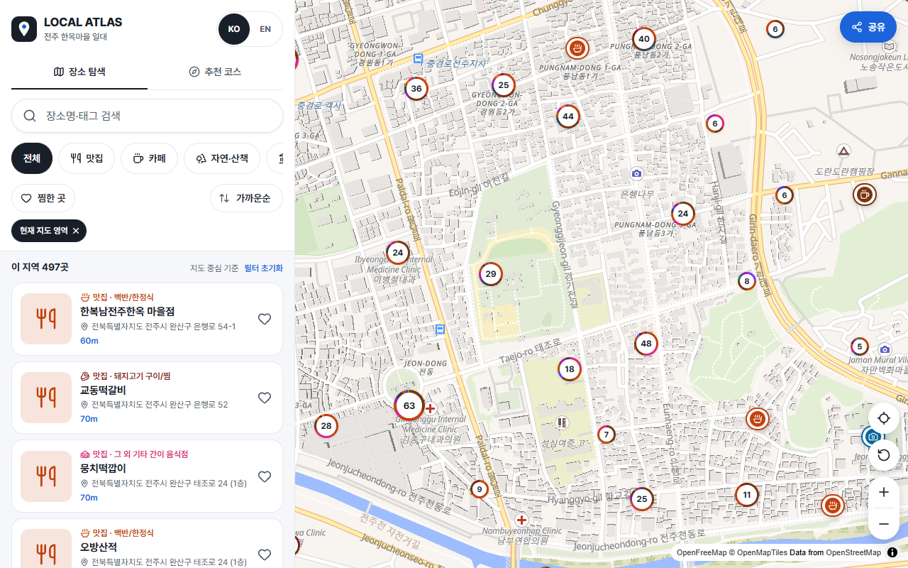
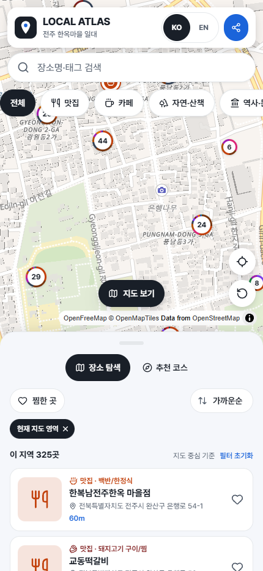

# LOCAL ATLAS — 우리 동네 여행 지도

> 나도 지역 크리에이터! AI로 만드는 '우리 동네 여행 지도' (12차시 강의 실습 프로젝트)

내 동네의 장소와 추천 코스를 담아 **링크 하나로 공유하는 여행 지도 웹서비스**입니다.
코딩을 몰라도 AI 코딩 도구(Claude Code, Codex 등)와 함께 만들고, GitHub + Vercel로 인터넷에 공개할 수 있습니다.

| 데스크톱 (1280px) | 모바일 (390 기준 · 바텀시트) |
|---|---|
|  |  |

> 📍 **실데이터 기반** — 전주 한옥마을 일대 **1,222곳**(2026-10-30 수집)과 실제 도보 경로 3개 코스를 담고 있습니다.
>
> | 데이터 | 출처 | 라이선스 |
> |---|---|---|
> | 음식점·카페 1,176곳 | 소상공인시장진흥공단 상가(상권)정보 (2026-06 기준) | 공공데이터, 이용허락범위 제한 없음 |
> | 역사·명소·자연 46곳 | OpenStreetMap (Overpass API), 주소는 Nominatim | ODbL 1.0 |
> | 다국어 이름·사진 연결 | Wikidata | CC0 |
> | 장소 설명(일부) | 위키백과 | CC BY-SA 4.0 (출처 링크 표기) |
> | 사진(일부) | Wikimedia Commons | 파일별 라이선스·저작자 표기 |
> | 코스 도보 경로 | OpenStreetMap 보행 네트워크 + **OSMnx** 최단경로 | ODbL 1.0 |
>
> 평점·가격·리뷰처럼 출처가 없는 정보는 만들지 않습니다. 사진이 없는 장소는 카테고리 플레이스홀더를 보여 줍니다. 상가 데이터는 등록 업종 기준이라 실제 영업 여부와 다를 수 있습니다.
>
> 🇰🇷 **전국 모드(완성본 확장)** — `DATABASE_URL` 을 설정하면 진흥공단 **전국 음식점·카페 약 84만 곳**을 PostGIS 에서 화면 범위만큼 읽어 보여 줍니다(§5-2). 데모: <https://local-travel-atlas-production.up.railway.app>. 강의(1~12차시)는 CSV 동네 모드 기준입니다.

## 1. 무엇을 할 수 있나요

| 기능 | 설명 |
|---|---|
| 인터랙티브 지도 | 클러스터(숫자)로 묶어 표시 → 누르면 확대. 핀은 **세부 업종 그룹별 색·아이콘**(한식·고기·분식·치킨·양식·중식·일식·해산물·아시안·주점·카페·빵·디저트, `lib/data/poi-style.ts`), 클러스터 테두리는 묶인 업종 비율 링. 확대/축소·내 위치·처음 위치 |
| 지도 영역 탐색 | "현재 지도 영역"의 장소만 목록에 표시, 지도를 옮기면 **이 지역에서 다시 찾기** |
| 정렬·찜 | 가까운순(내 위치/지도 중심 기준 거리 표시)·이름순·분류순, ♥ 찜(이 브라우저에만 저장) |
| 테마·세부 종류 필터·검색 | 맛집/카페/자연·산책/역사·문화/관광명소, 장소명·태그 검색, 결과 수·빈 결과 안내 |
| 장소 상세 | 마커·목록 어디서 열어도 같은 상세 패널(모바일은 바텀시트): 설명, 주소, 영업정보, 태그, 포함된 코스, 출처·라이선스, 길찾기, 공유 |
| 추천 코스 3종 | 번호 핀 + **OSMnx 로 계산한 실제 도보 경로**, 총·구간별 거리와 추정 시간(4.5km/h). 방문 순서마다 핀·구간 선 색이 달라 동선을 따라가기 쉬움 |
| 내 코스 | 장소 상세의 **내 코스에 추가**로 원하는 곳을 골라 순서대로 연결 → 순서 바꾸기·빼기·가까운 순 정렬, OSRM 실제 도보 경로·구간 거리, 링크로 공유(`?route=my-route&stops=…`). 경로 엔진이 없으면 직선 연결 + 안내 |
| 이동시간(선택) | OpenRouteService 키가 있으면 도보/차량 실제 경로·구간별 시간·거리 표시. 키가 없으면 제공하지 않으며 지어내지 않습니다 |
| 내 위치 | 버튼을 눌렀을 때만 위치 권한 요청, 서버에 저장하지 않음 |
| 한국어/영어 | 새로고침해도 유지, 영어 번역이 없으면 한국어로 대체 + 안내 |
| 공유·QR | 전체/코스/장소 링크, 복사, QR 이미지 저장, 네이티브 공유 |
| 모바일 | 지도 중심 + 상단 검색 바·테마 칩 + 끌어서 조절하는 3단계 바텀시트 + 목록/지도 전환 + safe-area |
| 방문 통계(선택) | Vercel Web Analytics 페이지 조회 (환경변수로 켜기) |

## 2. 사용 기술

Next.js (App Router) · React · TypeScript(strict) · Tailwind CSS · Lucide Icons · MapLibre GL JS · OpenFreeMap · Zod · PapaParse · qrcode · Vitest · Playwright

선택 이유는 [docs/ARCHITECTURE.md](docs/ARCHITECTURE.md)를 보세요.

## 3. 설치와 로컬 실행

필요한 것: [Node.js](https://nodejs.org) 20.9 이상 (Node 24에서 검증됨), Git

```bash
git clone <내 저장소 주소>
cd local-travel-atlas
npm install
npm run dev
```

브라우저에서 <http://localhost:3000> 을 엽니다. (처음 실행 시 지도 워커 파일이 `public/maplibre/`에 자동 복사됩니다.)

자주 쓰는 명령어

| 명령어 | 하는 일 |
|---|---|
| `npm run dev` | 개발 서버 |
| `npm run validate:data` | 장소 CSV·코스 JSON 검사 (**데이터를 고친 뒤 꼭 실행**) |
| `npm run typecheck` / `npm run lint` | 타입·코드 검사 |
| `npm test` | 단위 테스트 |
| `npm run test:e2e` | 브라우저(데스크톱+모바일) 테스트 — 처음 한 번 `npx playwright install chromium` |
| `npm run build` && `npm start` | 배포용 빌드 확인 |

## 4. 환경변수

`.env.example` 을 복사해 `.env.local` 을 만듭니다. **모두 선택**이며, 하나도 없어도 서비스는 동작합니다.

| 이름 | 용도 |
|---|---|
| `ORS_API_KEY` | 실제 경로·이동시간. [OpenRouteService](https://openrouteservice.org/dev/#/signup) 무료 키. **서버 전용** — `NEXT_PUBLIC_` 를 붙이지 마세요 |
| `NEXT_PUBLIC_MAP_STYLE_URL` | 지도 스타일 변경 (기본 OpenFreeMap Liberty) |
| `NEXT_PUBLIC_ENABLE_ANALYTICS` | `true` 면 Vercel Web Analytics 로드 |
| `NEXT_PUBLIC_SITE_URL` | 공유·QR 기준 주소 고정(비우면 현재 주소) |
| `DATABASE_URL` | 전국 모드 PostGIS 주소(§5-2). 비우면 CSV 동네 모드. **서버 전용** |
| `OSRM_URL` | 내 코스 도보 경로 엔진(OSRM, `services/osrm`). 비우면 직선 연결. **서버 전용** |

`.env.local` 은 Git에 올라가지 않습니다(`.gitignore`). 키를 코드·채팅·스크린샷에 노출하지 마세요.

## 5. 내 동네로 바꾸기

1. **브랜드·지역·지도 중심** — [config/site.ts](config/site.ts)
2. **색상·글꼴** — [app/theme.css](app/theme.css)
3. **카테고리·테마** — [data/categories.json](data/categories.json)
4. **장소** — [data/places.csv](data/places.csv)
5. **코스** — [data/routes.json](data/routes.json)

### 장소 데이터(CSV) 수정

엑셀·구글 시트·VS Code 어디서든 열 수 있습니다. **저장할 때 "CSV UTF-8"** 로 저장하세요(한글 깨짐 방지).

| 열 | 필수 | 설명 |
|---|---|---|
| id | ✅ | 영문 소문자·숫자·하이픈 (예: `cafe-ivy`), 중복 불가 |
| nameKo / nameEn | ✅ / 열은 필수 | 영어는 비워도 됨(한국어로 대체 표시) |
| latitude, longitude | ✅ | 위도(−90~90), 경도(−180~180). 구글/네이버 지도에서 우클릭으로 확인 |
| category | ✅ | `categories.json` 의 id |
| theme | ✅ | `categories.json` themes 의 id |
| descriptionKo / descriptionEn | ✅ / 열은 필수 | 설명 |
| address | ✅ | 주소 |
| imageUrl | 열 필수 | 비워 두면 플레이스홀더. 직접 촬영 사진은 `public/images/` 에 넣고 `/images/파일명.jpg` |
| source, license | ✅ | 데이터 출처, 이용 조건 |
| openingHours, tags(`\|`로 구분), externalUrl, recommendedDurationMinutes, updatedAt(YYYY-MM-DD), isSample(`true`/`false`) | 선택 | |

수정 후:

```bash
npm run validate:data
```

`✅ 데이터 검증 통과` 가 나오면 성공, `❌` 가 나오면 알려 주는 행·열을 고칩니다.

### 코스(JSON) 수정

[data/routes.json](data/routes.json) 에서 `placeIds` 의 **순서가 곧 방문 순서**입니다. 장소 id는 CSV에 있는 것만 쓸 수 있고, 코스당 2곳 이상(권장 5~8곳)입니다.

## 5-1. 실데이터 다시 수집하기 (선택 · Python)

웹 앱은 저장소의 `data/` 파일만 읽습니다. **실행·배포에 API 키가 필요 없습니다.** 데이터를 갱신할 때만 아래를 실행합니다.

```bash
python -m venv .venv
.venv/Scripts/pip install -r scripts/data-pipeline/requirements.txt   # macOS/Linux: .venv/bin/pip
# (선택) .env.local 에 SEMAS_SERVICE_KEY=<공공데이터포털 일반 인증키(Decoding)>  — 없으면 음식점·카페는 OSM 데이터 사용
.venv/Scripts/python scripts/data-pipeline/fetch_places.py   # → data/places.csv
.venv/Scripts/python scripts/data-pipeline/build_routes.py   # → data/route-paths.json (OSMnx 실제 도보 경로)
npm run validate:data
```

- 수집 범위(BBOX)는 `fetch_places.py` 상단, 지도 중심은 `config/site.ts` 에서 바꿉니다.
- 공용 Overpass 서버는 혼잡하면 502 를 반환합니다 → 스크립트가 자동으로 재시도합니다.
- 코스(`data/routes.json`)를 바꾸면 `build_routes.py` 를 다시 실행해야 경로가 갱신됩니다(구간 수가 다르면 검증이 알려 줌).
- 응답은 `scripts/data-pipeline/cache/` 에 저장되어 재실행 시 재사용됩니다(Git 제외).

## 5-2. 전국 모드 (선택 · PostGIS + OSRM)

첫 화면은 **서울 서초구 양재역 일대**(`config/site.ts` 의 `nationwide`)이고, 추천 코스는 양재역 일대 3종(`data/nationwide/` — OSM 명소 30곳 + OSMnx 도보 경로: 양재천 물길 산책 4.5km, 양재역 서쪽 전시관 산책 3.0km, 도곡동 동네 공원 잇기 3.3km)과 전주 3종입니다.

```bash
.venv/Scripts/python scripts/data-pipeline/fetch_places.py yangjae   # → data/nationwide/yangjae-places.csv (명소·역사·자연만)
.venv/Scripts/python scripts/data-pipeline/build_routes.py yangjae   # → data/nationwide/route-paths.json
DATABASE_URL=... .venv/Scripts/python scripts/data-pipeline/load_postgres.py --curated-only   # 코스 방문지만 DB 반영
```

CSV 에 담기 어려운 전국 데이터는 DB 에서 **지금 보이는 지도 범위만** 받아 옵니다. 줌이 낮으면 서버가 격자로 묶은 클러스터를, 화면 안이 1,500곳 이하면 개별 장소를 보냅니다. 목록은 화면 중심에서 가까운 100곳입니다.

```bash
.venv/Scripts/python scripts/data-pipeline/semas_nationwide.py   # 진흥공단 전국 '음식' 업소(약 84만) → data/raw/ (페이지 캐시로 이어받기)
DATABASE_URL=postgresql://... .venv/Scripts/python scripts/data-pipeline/load_postgres.py   # PostGIS 적재(새 테이블 → 교체)
```

| 구성 | 위치 | 비고 |
|---|---|---|
| 장소 API | `app/api/places/route.ts`, `lib/server/places-db.ts` | `GET ?bbox&z&cx&cy[&cat&sub&q]` 클러스터·장소·목록, `?ids=` id 조회, `?extent=1&q=` 검색 범위 |
| 도보 경로 API | `app/api/walk/route.ts`, `lib/routing/osrm.ts` | `POST {placeIds}` — 좌표는 서버가 조회, 구간별 형상 반환 |
| 경로 엔진 | `services/osrm/` | 대한민국 OSM(Geofabrik) foot 프로필, 첫 시작 시 전처리 후 `/data` 볼륨에 보관 |

Railway 에서는 앱 서비스 변수에 `DATABASE_URL=${{PostGIS.DATABASE_PRIVATE_URL}}`, `OSRM_URL=http://osrm.railway.internal:5000` 을 넣습니다(내부망, 외부 공개 없음).

## 6. Vercel 배포 (요약)

1. GitHub에 저장소를 올립니다 → 2. [vercel.com](https://vercel.com) 에서 **Add New → Project → 저장소 Import** → 3. (선택) Environment Variables에 `ORS_API_KEY` 등록 → 4. **Deploy** → 5. 나온 주소를 열어 확인.
이후 데이터를 고치고 `git push` 하면 **자동으로 다시 배포**됩니다. 자세한 단계는 [docs/DEPLOYMENT.md](docs/DEPLOYMENT.md).

## 7. 문제 해결 FAQ

**Q. 지도가 하얗게(베이지색) 보이고 도로가 없어요.** 타일을 받는 중이거나 인터넷이 끊긴 것입니다. 잠시 기다리거나 새로고침하세요. 계속되면 "지도를 불러오지 못했습니다" 안내와 **다시 시도** 버튼이 나타납니다. WebGL이 꺼진 브라우저/원격 환경에서도 같은 안내가 나옵니다.

**Q. `npm run validate:data` 가 한글 깨짐(�)을 알려요.** CSV를 UTF-8로 다시 저장하세요(엑셀: 다른 이름으로 저장 → CSV UTF-8).

**Q. 저장했는데 화면이 안 바뀌어요.** 개발 서버는 데이터 파일이 바뀌면 새로고침으로 반영됩니다. 배포 사이트는 `git push` 후 Vercel 배포가 끝나야 반영됩니다.

**Q. 이동시간 버튼이 없어요.** `ORS_API_KEY` 가 없으면 정상입니다. 키를 `.env.local`(로컬) 또는 Vercel 환경변수(배포)에 넣고 **다시 빌드/재배포**하세요(키는 빌드 때 확인합니다).

**Q. 이동시간이 "불러오지 못했습니다"로 나와요.** 키 오류·무료 한도 초과·일시적 장애일 수 있습니다. 지도와 코스는 그대로 쓸 수 있습니다.

**Q. QR을 찍었는데 열리지 않아요.** 로컬(`localhost`) 주소로 만든 QR입니다. 배포된 공개 주소에서 다시 만드세요(화면에 안내가 뜹니다).

**Q. 위치 버튼이 안 돼요.** 브라우저의 위치 권한을 허용해야 하고, `https` 또는 `localhost` 에서만 동작합니다.

**Q. 이미지를 넣어도 안 보여요.** 파일은 `public/images/` 에, CSV에는 `/images/파일명.jpg` 로 적습니다. 사진은 직접 촬영하거나 사용이 허가된 것만 쓰세요.

## 8. 문서 지도

| 문서 | 내용 |
|---|---|
| [PRD.md](PRD.md) | 제품 요구사항 |
| [docs/ARCHITECTURE.md](docs/ARCHITECTURE.md) | 구조·데이터 흐름·기술 선택 이유 |
| [docs/DEPLOYMENT.md](docs/DEPLOYMENT.md) | GitHub → Vercel 단계별 |
| [docs/OPERATIONS.md](docs/OPERATIONS.md) | 운영·점검 |
| [docs/COURSE_INDEX.md](docs/COURSE_INDEX.md) | 12차시 진행표 |
| [docs/course/](docs/course/) | 차시별 강의 문서 lesson-01 ~ 12 |
| [docs/prompts/](docs/prompts/) | 복사해서 쓰는 AI 코딩 프롬프트 |
| [docs/TEST_REPORT.md](docs/TEST_REPORT.md) | 실제 수행한 테스트와 미검증 항목 |

## 9. 라이선스·출처

- 지도 © [OpenFreeMap](https://openfreemap.org) © [OpenMapTiles](https://openmaptiles.org) · 데이터 © [OpenStreetMap](https://www.openstreetmap.org/copyright) 기여자 (지도 화면 오른쪽 아래에 항상 표시)
- 장소: OpenStreetMap 기여자(ODbL 1.0) · 소상공인시장진흥공단 상가(상권)정보(공공데이터) · Wikidata(CC0) · 위키백과(CC BY-SA 4.0, 장소별 출처 링크) · 사진 Wikimedia Commons(파일별 저작자·라이선스 표기)
- 도보 경로: OpenStreetMap 보행 네트워크 + OSMnx(MIT)
- 강의용 가상 샘플 30곳은 `data/samples/` 에 별도로 보관합니다(앱은 읽지 않음, 3~7차시 실습용).
- 코드는 강의 실습용으로 자유롭게 수정할 수 있습니다.
